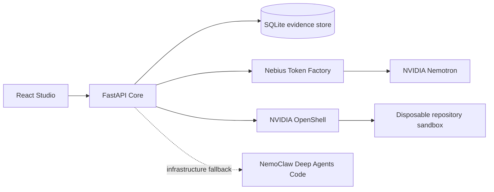

# Multiverse

Multiverse is a bounded coding-agent workbench for repository tasks. It uses NVIDIA Nemotron models through Nebius Token Factory, executes approved work inside NVIDIA OpenShell, records reproducible evidence, and turns only reviewed evidence into reusable memory.

The central loop is:

`Inspect -> Approve -> Execute -> Record -> Verify -> Review -> Evaluate`

Multiverse does not claim that memory changes model weights. Memory is reviewed context, and its value is measured against a matched no-memory baseline.

## Architecture



- `app/`: responsive React product pages and Studio for task review, run evidence, memory, and evaluations.
- `core/`: FastAPI Core, fixture evaluation harness, repository inspection, routing, artifacts, and review state.
- `.cursor/skills/multiverse-nebius/`: reusable Nebius/NVIDIA integration and diagnostics skill.
- `deploy/`: OpenShell policy templates, runner image recipe, and Nebius host configuration.

## What works

- Existing curated fixture evaluation with hidden checks and reviewed memory.
- Public HTTPS repository inspection pinned to a full commit SHA.
- Deterministic Python, Node, and Rust execution-plan detection.
- Immutable plan review before a repository task can start.
- Deterministic Lightning to Super to Ultra routing through Token Factory.
- OpenShell-only repository execution with no unsafe local fallback.
- Infrastructure-only NemoClaw fallback before the first valid coding attempt.
- Append-only run events and downloadable patch, checks, usage, trace, and manifest artifacts.
- Paired no-memory versus reviewed-memory repository evaluations.

Public repository tests produce `checks_passed`. Only the curated corpus, where checks remain hidden from the agent, can produce `verified`.

## Local setup

Requirements:

- Python 3.11 or newer for the current OpenShell SDK/CLI ecosystem.
- Node.js and npm.
- WSL2 on Windows, with a running Linux Docker daemon.
- NVIDIA OpenShell CLI connected to a gateway.
- A runner image built from `deploy/runner/Dockerfile` and published with a digest.

Install and start Core:

```powershell
cd core
python -m venv .venv
.venv\Scripts\python -m pip install -e ".[test]"
$env:MULTIVERSE_DB = "$PWD\multiverse.db"
.venv\Scripts\python -m multiverse_core serve --port 8000
```

Start Studio in another terminal:

```powershell
cd app
npm ci
npm run dev
```

Before a live repository run, configure only the host environment:

```text
NEBIUS_API_KEY
NEBIUS_MODEL_LIGHTNING
NEBIUS_MODEL_SUPER
NEBIUS_MODEL_ULTRA
MULTIVERSE_RUNNER_IMAGE=registry.example/multiverse-runner@sha256:<digest>
MULTIVERSE_OPENSHELL_SETUP_POLICY_PYTHON=<absolute path>/deploy/openshell/setup-python-policy.yaml
MULTIVERSE_OPENSHELL_SETUP_POLICY_NODE=<absolute path>/deploy/openshell/setup-node-policy.yaml
MULTIVERSE_OPENSHELL_SETUP_POLICY_RUST=<absolute path>/deploy/openshell/setup-rust-policy.yaml
MULTIVERSE_OPENSHELL_RUN_POLICY=<absolute path>/deploy/openshell/run-policy.yaml
```

Never place `NEBIUS_API_KEY` in browser variables, command arguments, SQLite, traces, repository files, or sandbox environment variables.

## Diagnostics

```powershell
python .cursor/skills/multiverse-nebius/scripts/token_factory.py doctor --output doctor.json
python .cursor/skills/multiverse-nebius/scripts/token_factory.py models --output models.json
python .cursor/skills/multiverse-nebius/scripts/token_factory.py tool-smoke --model $env:NEBIUS_MODEL_LIGHTNING --output smoke.json
```

## Security boundaries

- Repository URLs must use public HTTPS without embedded credentials.
- Hosts resolving to private or reserved addresses are rejected.
- Redirects, submodule initialization, Git LFS downloads, and local Git protocols are disabled.
- Repository size, source size, file count, clone time, run time, attempts, and model tokens are bounded.
- Dependency setup receives only reviewed package-registry egress.
- Editing and checks use a deny-by-default network policy.
- The MVP does not accept secrets, Git writes, branch creation, commits, or pull requests.
- SQLite and the in-process worker are suitable for one hackathon instance, not horizontal production deployment.

See `docs/architecture/nebius-hackathon.md` for the complete runtime contract and `docs/demo-script.md` for the submission walkthrough.

## Validation

```powershell
cd core
python -m unittest discover -s tests -v

cd ..\app
npm run typecheck
npm run build

python C:\Users\simok38\.codex\skills\.system\skill-creator\scripts\quick_validate.py .cursor\skills\multiverse-nebius
```

Live OpenShell and Token Factory tests are intentionally opt-in because they require configured infrastructure and credentials.

## License

Apache-2.0. See `LICENSE`.
